# Hi, I’m Dairelys García Rivas (Hydra)

I’m a software engineer focused on full-stack development. I enjoy learning new technologies and working with teams to build useful software. My experience includes web applications, APIs, project coordination, and Linux distribution development.

I’ve worked with Python, Java, TypeScript, JavaScript, Vue.js, Angular, Django, Spring Boot, Ionic, Docker, and Linux. I’m currently freelancing and continuing to build with Django and modern frontend tools.

## Selected projects

### GradeFlow (student-grades)

Freelance project: a student management system for organizing students and grades. The dashboard includes tests, payments, a calendar, course management, and separate student views.

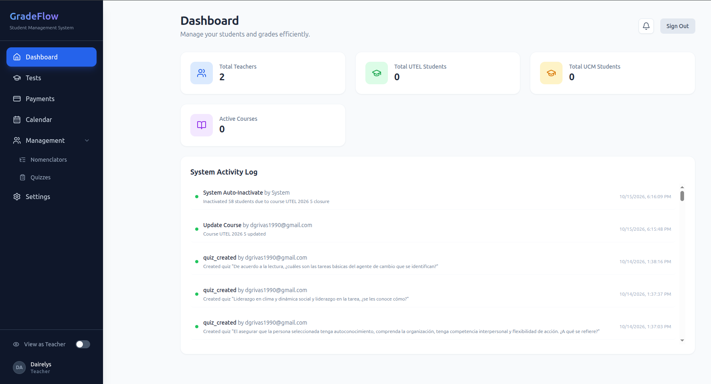

### Cárnicos El Rey website

Built a website from a supplied design for a Cuban food company.

[Visit the website](https://www.elreysrl.com/home) · [Alternate site](https://elrey.guajisoft.com/)

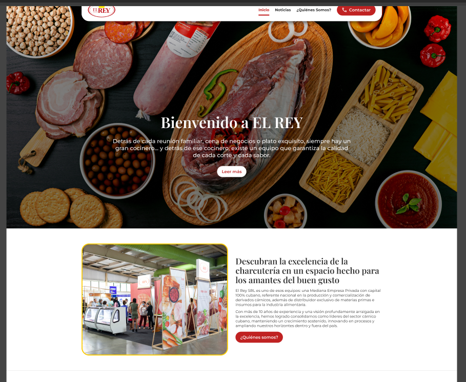

### BeFit

A gym management platform connecting gym administrators, trainers, and customers. The backend uses Django and Django REST Framework; the frontend uses Vue 3, TypeScript, Vite, and Tailwind CSS.

[View the repository](https://github.com/hydra1990/BeFit)

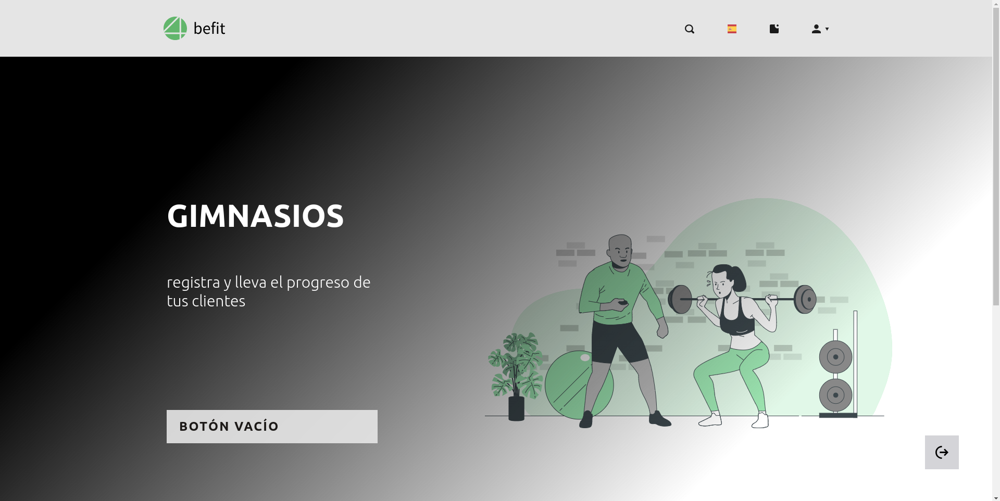

### RepCom

A web application for tracking diners across community dining halls, with user, role, and diner management. Built with Vue, Vite, and Tailwind CSS on the frontend, Django REST Framework on the backend, and Docker.

[View the repository](https://github.com/hydra1990/RepCom)

### LizardFS monitoring interface

Rebuilt the monitoring interface in Vue.js and connected it to the LizardFS monitoring API. The updated interface preserved the familiar workflow for system administrators while making future features easier to add.

[View the repository](https://github.com/hydra1990/lizardfs-monitor-web)

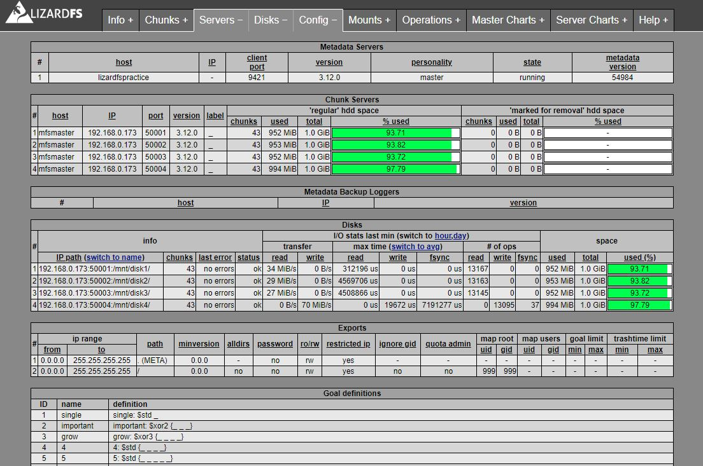

### LizardFS registration tools

Built a Vue.js registration form and a Python API to record users requesting access to LizardFS package downloads.

[Registration form](https://github.com/hydra1990/lizardfs-registration-form) · [API](https://github.com/hydra1990/lfs-registration-api)

### Sinterit NILS 480 3D printer

Worked in a five-person team to build a Vue.js touchscreen interface for an industrial SLS 3D printer, using a customer-provided emulator during development.

[Product information](https://sinterit.com/3dprinters/nils-480/) · [Project repository](https://github.com/Pawel345435/sinterit_web)

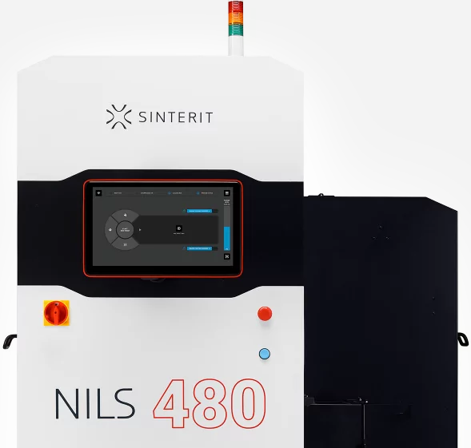

### Cuban.engineer talent platform

Contributed to a talent platform matching Cuban engineers with software projects. I worked on backend development with Java and Spring Boot, frontend development with Angular, and project coordination.

[Visit Cuban.engineer](https://cuban.engineer/)

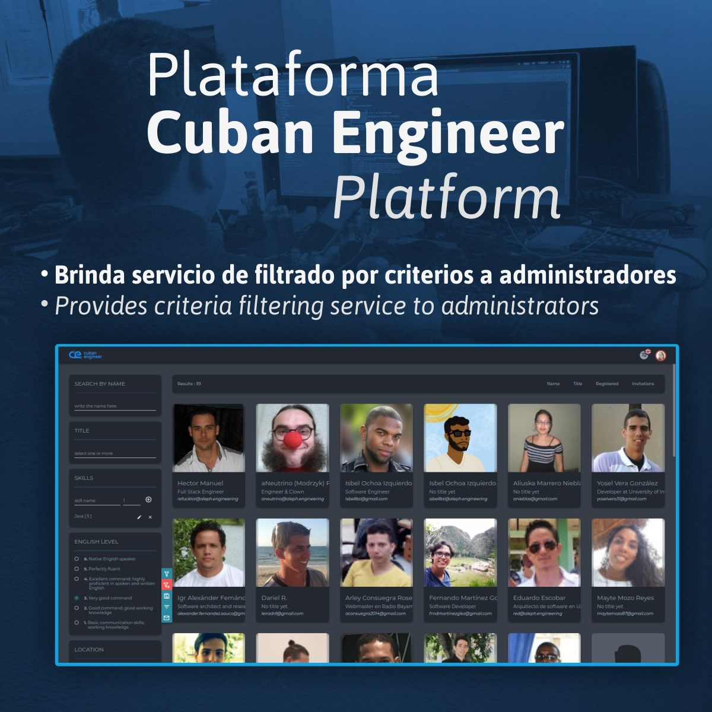

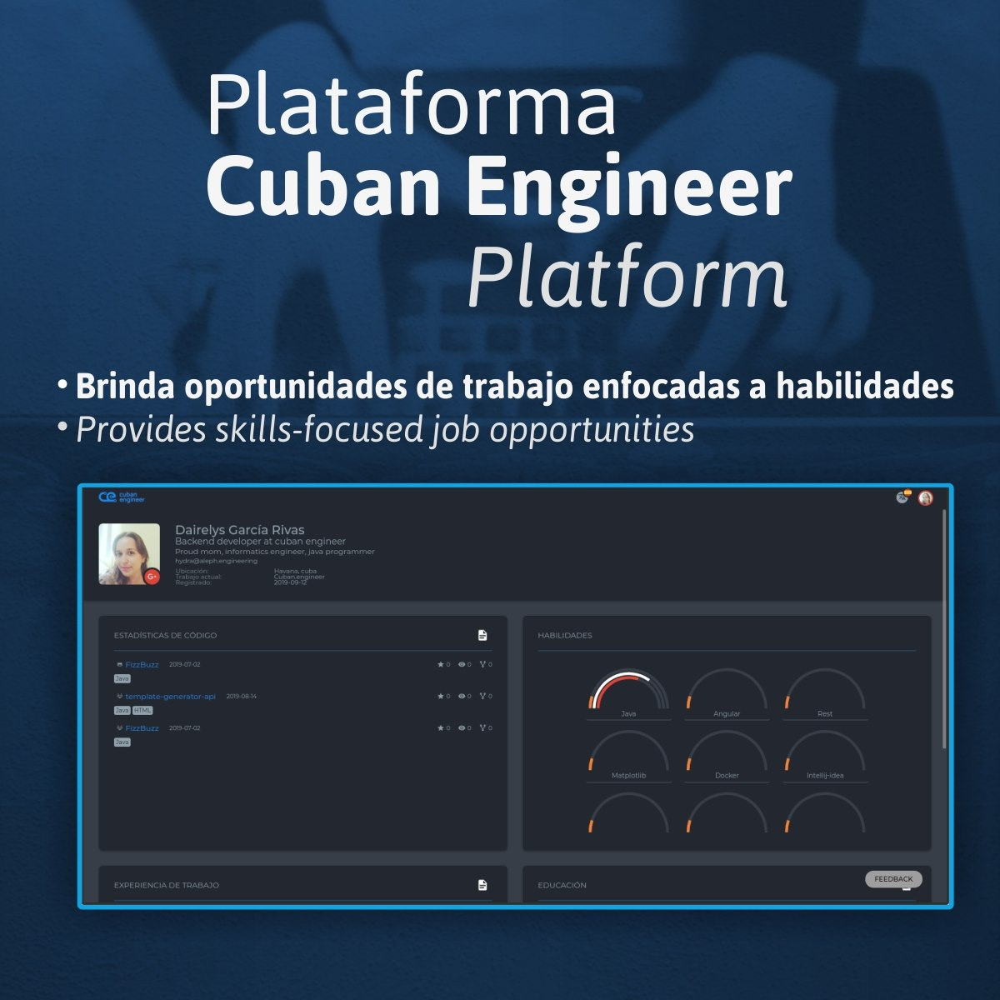

### Imagined Earth

Helped fix and complete an Ionic mobile app that encouraged recycling through rewards and offers at reverse vending machines.

[Google Play listing](https://play.google.com/store/apps/details?id=com.imaginedearth.app&hl=en&gl=US)

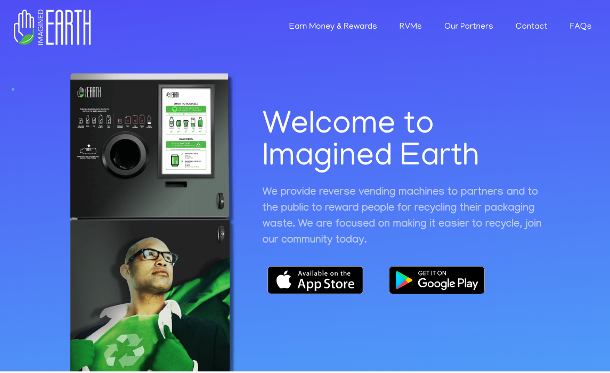

### Nova GNU/Linux

Worked on Nova Light, a lightweight edition of Cuba’s Nova GNU/Linux distribution for computers with limited hardware. I later led the operating systems department responsible for Nova Light, Nova Desktop, and Nova Server.

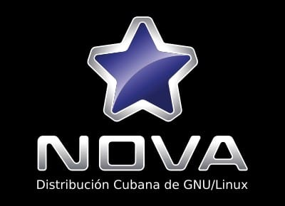

### More work

- [SGOC](https://github.com/hydra1990/sgoc): a system for recording and reporting cash transactions for a Cuban institution.
- [LizardFS registration API](https://github.com/hydra1990/lfs-registration-api): a Python API supporting the package download registration flow.
- [Nova GNU/Linux](https://www.nova.cu/): Cuban GNU/Linux distribution.

## Experience

### Web Developer · LuHos Group
**September 7, 2026 – Present**

### Web Developer · Guajiritos S.R.L.
**October 2025 – February 2026** · Developed software for tourism, hotel, and travel management, as well as websites for local businesses.

### Software Developer · Freelance
**January 2024 – Present** · Freelance projects include GradeFlow (student-grades) and TimeTracker.

### Software Developer · LEIL Storage
**January – June 2023** · Developed a monitoring platform.

### Software Developer · LizardFS
**November 2021 – January 2022** · Worked on the monitoring interface and user registration tools.

### Software Developer and Project Manager · Cuban.engineer
**June 2019 – November 2022** · Contributed to the talent platform and coordinated project work, including boards, stand-ups, and sprint planning.

### International Relations Officer · University of Informatics Sciences
**January 2017 – August 2019**

### Earlier work · University of Informatics Sciences
**2012 – 2016** · Developed the Nova GNU/Linux distribution, led the operating systems department, and taught English.

### ICT Network Administrator · Medical Mission Barrio Adentro
**August 2010 – April 2011** · Maintained LAN/WAN connectivity and server services at a diagnostic center in Venezuela.

## Skills

- **Languages:** Python, Java, TypeScript, JavaScript, Bash, HTML, CSS, LaTeX
- **Frameworks:** Django, Vue.js, Angular, Spring, Spring Boot, Ionic
- **Tools and practices:** Git, Linux, Docker, Jenkins, GitLab CI/CD, TDD, JUnit, Jasmine, Karma, Scrum, Kanban, XP
- **Databases:** SQLite, MySQL

## Education

**Engineer of Information Sciences** · University of Informatics Sciences, 2007–2012

## Languages

Spanish (native) · English (C1)

## GitHub statistics

<picture>
  <source media="(prefers-color-scheme: dark)" srcset="./profile-stats/overview.dark.svg" />
  
</picture>

<picture>
  <source media="(prefers-color-scheme: dark)" srcset="./profile-stats/contributions.dark.svg" />
  
</picture>

<picture>
  <source media="(prefers-color-scheme: dark)" srcset="./profile-stats/composition.dark.svg" />
  
</picture>

<picture>
  <source media="(prefers-color-scheme: dark)" srcset="./profile-stats/languages.dark.svg" />
  
</picture>

## Publications and recognition

- Co-author, [“Cuban GNU/Linux Nova Distribution for Server Computers”](https://www.researchgate.net/publication/282769958_Cuban_GNULinux_Nova_Distribution_for_Server_Computers), 2014.
- Author, [“Book Locator: Books Manager”](https://www.researchgate.net/publication/282769762_Book_Locator_Books_Manager), 2014.
- Co-author, [“Evaluación de la prensa digital cubana respecto a la optimización para motores de búsqueda”](http://publicaciones.uci.cu/index.php/SC/article/view/1766), 2016.
- Second place as part of a team at the 2015 Developing the Caribbean code sprint.
